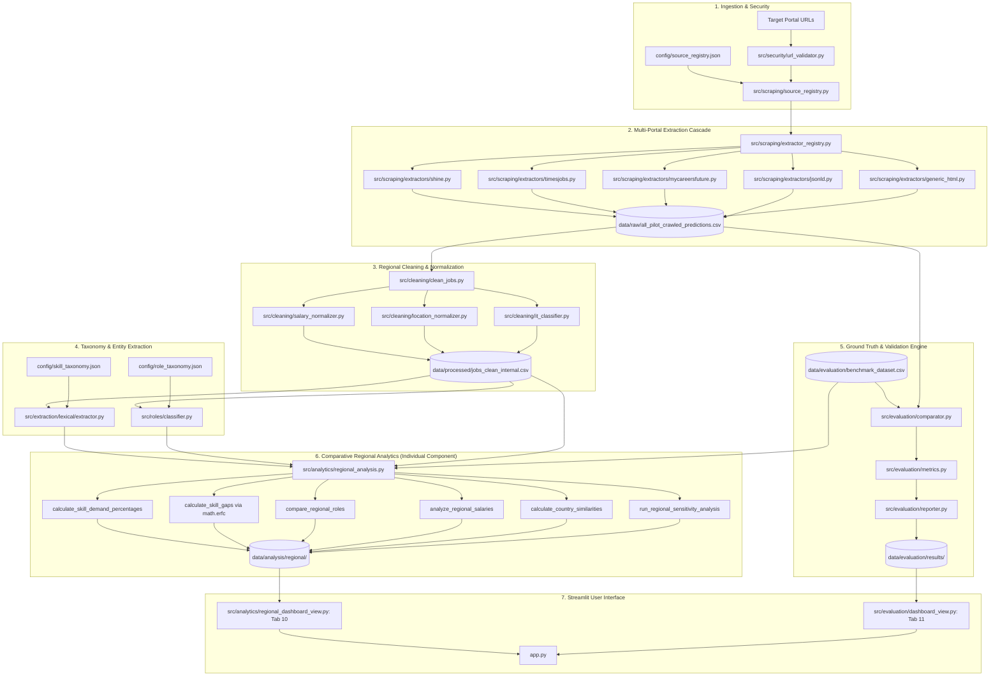

# Individual Component File Documentation

**Project ID:** J26-SE-355  
**Project Title:** Quantitative Analysis Framework for Technical Skill Identification for IT Sector Jobs  
**Individual Research Component:** Comparative Regional Market Analysis (Sri Lanka, India, Singapore, Malaysia)  
**Author / Lead Investigator:** Individual Component Specialist (Registration / Seat No: J26_SE_355)  
**Current Branch:** `feature/regional-market-data-validation`  
**Latest Commit:** `a179886acd74ce82c000a29ecc19b5081299053a`  
**Date of Assessment:** October 2026  

---

## 1. Executive Summary

This document establishes the comprehensive technical, algorithmic, and architectural file documentation for the individual research component: **Comparative Regional Market Analysis** within Project `J26-SE-355`. The individual research investigation quantifies, compares, and evaluates technical skill demand, IT occupational role distributions, and disclosed compensation patterns across South and Southeast Asian IT employment hubs—centering on **Sri Lanka (LK)** as the primary focal labor market, with **India (IN)**, **Singapore (SG)**, and **Malaysia (MY)** serving as regional comparator markets.

To address the methodological fragility common to empirical labor-market informatics (such as scraper hallucination, denominator bias, false country attribution, and nominal salary incomparability), this research component implemented a verifiable, reproducible pipeline spanning Tasks 1 through 7:
1. **Regional Schema & Normalization:** Standardized salary boundaries, pay periods (hourly, daily, monthly, annual), currency tokens (`LKR`, `INR`, `SGD`, `MYR`), and location/work-mode disaggregation.
2. **Ground-Truth Benchmark Dataset:** Created an independently audited 120-advertisement ground-truth corpus with field-level verification statuses (`verified`, `unavailable`, `ambiguous`, `not_reviewed`).
3. **Extraction Accuracy & Error Measurement:** Established a formal evaluation engine computing exact and normalized agreement rates, Wilson score 95% confidence intervals, and Mean Absolute Error (MAE) on numeric compensation.
4. **Foreign Job Portal Integration & Ethical Governance:** Built dedicated site adapters (`shine.com`, `timesjobs.com`, `mycareersfuture.gov.sg`) and an ethical source registry enforcing polite request throttling and SSRF security.
5. **Human-in-the-Loop Validation Dashboard:** Designed a dedicated Streamlit validation interface (Tab 11) with an immutable reviewer audit queue.
6. **Validated Comparative Regional Analysis:** Developed the quantitative analysis engine computing canonical skill demand percentages ($D_{s,c}$), two-proportion z-tests for regional skill gaps, role distribution comparisons, and multidimensional country similarities across 5 sensitivity analysis regimes.
7. **Comprehensive Regression & Reproducibility Suite:** Built an offline regression suite verifying all pipeline stages on local fixtures, ensuring zero dependencies on live portals and full audit determinism (224 passing tests).

---

## 2. Project and Individual Component Scope

### 2.1 Wider Project Architecture
The overall tool `J26-SE-355` provides an end-to-end intelligence framework designed to scrape web advertisements from online tech job portals, extract technical skills using natural language processing (NLP) and dictionary matching, classify job advertisements into standardized roles, analyze co-occurrence relationships, and present insights via a web dashboard.

### 2.2 Individual Component Scope: Comparative Regional Market Analysis
The individual research contribution focuses specifically on cross-border labor market comparability:
- **Focal Market:** Sri Lanka (benchmark baseline).
- **Comparator Markets:** Singapore (advanced ASEAN tech hub), Malaysia (emerging ASEAN tech hub), India (high-volume regional hub).
- **Core Research Questions (RQs):**
  - **RQ1 (Skill Demand Parity):** What technical skills are statistically over- or under-represented in Sri Lanka relative to comparator economies?
  - **RQ2 (Structural Role Composition):** How do IT role distributions differ across regional labor markets, and how does specialization align with regional skill shortages?
  - **RQ3 (Compensation Transparency):** What proportion of job postings disclose compensation, and how do monthly equivalent salary distributions vary across comparable roles in native currencies?
  - **RQ4 (Extraction Validity & Reproducibility):** To what extent does automated extraction error impact cross-country statistical conclusions, and are empirical results robust to alternative data quality thresholds?

### 2.3 Boundary: Individual Contribution vs. Shared Team Infrastructure

| Subsystem / Area | Shared Team Infrastructure | Individual Research Component (J26_SE_355) |
| :--- | :--- | :--- |
| **Web Scraping** | Topjobs Sri Lanka scraper, Playwright fallback | Configurable `SourceRegistry`, foreign portal adapters (`Shine`, `TimesJobs`, `MyCareersFuture`), SSRF validation, and offline fixtures. |
| **Data Cleaning** | Base HTML cleaning, legacy CSV loading | Regional schema migration, multi-currency detection (`LKR`, `INR`, `SGD`, `MYR`), pay-period normalization, location/work-mode disaggregation. |
| **Skill Extraction** | Lexical taxonomy matcher (`LexicalSkillExtractor`), semantic embedder | Multi-market canonical skill aggregation, deduplicated ad-level counting, identical country denominators. |
| **Role Classification** | Role taxonomy keywords (`RoleClassifier`) | Regional role share distributions, unclassified audit tracking, role-segmented skill demand. |
| **Quality & Benchmark** | Basic data validation checks | Independent 120-ad ground-truth benchmark, field-level comparator, Wilson score CIs, MAE numeric error, reproducibility manifests. |
| **Analytics** | Co-occurrence matrix, Apriori association rules, network graphs | Cross-national skill gap z-tests, profile similarities (Cosine, Jaccard, Spearman), 5-regime sensitivity analysis, native currency salary metrics. |
| **User Interface** | Tabs 1–9 (Collect, Raw, Clean, Skills, Associations, Quality, Logs, Domains, Reviews) | **Tab 10:** Comparative Regional Analysis (6 sub-views) and **Tab 11:** Scraping Accuracy & Validation. |
| **Testing** | Unit tests for lexical extraction and basic cleaning | Dedicated regional test suites, benchmark evaluation tests, foreign adapter tests, comprehensive regression suite (36 tests, 224 total passing). |

---

## 3. Repository Structure Relevant to the Component

```text
J26_SE_355/
├── app.py                                # Main Streamlit application (hosts Tab 10 & Tab 11)
├── theme.py                              # Visual design system (CSS, tables, cards, pills)
├── config/                               # Central configuration and taxonomies
│   ├── approved_domains.txt              # Ethical web scraping domain whitelist
│   ├── blocked_domains.txt               # Blocked / malicious domain blacklist
│   ├── role_taxonomy.json                # Standardized IT occupational taxonomy (12 roles)
│   ├── skill_taxonomy.json               # Canonical technical skill dictionary (350+ skills)
│   └── source_registry.json              # Foreign portal configurations (LK, IN, SG, MY)
├── data/
│   ├── analysis/regional/                # Reproducible regional analysis outputs (CSVs & MD)
│   │   ├── country_similarity_matrix.csv
│   │   ├── regional_analysis_report.md
│   │   ├── regional_eligibility_funnel.csv
│   │   ├── role_distribution_by_country.csv
│   │   ├── role_skill_demand_regional.csv
│   │   ├── salary_by_role_regional.csv
│   │   ├── salary_summary_by_country.csv
│   │   ├── sensitivity_analysis_summary.csv
│   │   ├── skill_demand_by_country.csv
│   │   ├── skill_gaps_focal_srilanka.csv
│   │   └── unclassified_roles_summary.csv
│   ├── evaluation/                       # Ground-truth benchmark and evaluation results
│   │   ├── ANNOTATION_GUIDE.md           # Benchmark auditing protocol
│   │   ├── BENCHMARK_DOCUMENTATION.md    # Ground-truth dataset documentation
│   │   ├── SAMPLING_METHODOLOGY.md       # Stratified sampling guidelines
│   │   ├── benchmark_dataset.csv         # 120 verified ground-truth advertisements
│   │   ├── benchmark_dataset.json        # Structured JSON ground truth
│   │   └── results/                      # Timestamped evaluation run outputs
│   │       ├── evaluation_errors_latest.csv
│   │       ├── evaluation_metrics_latest.json
│   │       ├── evaluation_report_latest.md
│   │       └── evaluation_reproducibility_latest.json
│   └── raw/
│       ├── all_pilot_crawled_predictions.csv # Cross-national raw pilot crawls
│       └── collection_manifest.json          # Scrape batch tracking manifest
├── src/
│   ├── analytics/
│   │   ├── regional_analysis.py          # Core quantitative engine & CLI
│   │   └── regional_dashboard_view.py    # Streamlit Tab 10 presentation module
│   ├── cleaning/
│   │   ├── clean_jobs.py                 # Multi-stage cleaning and deduplication
│   │   ├── it_classifier.py              # IT relevance heuristic classifier
│   │   ├── location_normalizer.py        # Regional gazetteer & work-mode extractor
│   │   └── salary_normalizer.py          # Multi-currency salary parser & converter
│   ├── evaluation/
│   │   ├── build_benchmark.py            # Benchmark creation & sampling tool
│   │   ├── comparator.py                 # Field-by-field comparator & error classifier
│   │   ├── dashboard_data.py             # Evaluation metrics loading & annotation store
│   │   ├── dashboard_view.py             # Streamlit Tab 11 presentation module
│   │   ├── evaluate_scraping.py          # Evaluation CLI runner
│   │   ├── metrics.py                    # Statistical metrics (Wilson CIs, MAE, Macro F1)
│   │   ├── reporter.py                   # Academic Markdown and JSON manifest reporter
│   │   └── schema.py                     # Benchmark schema definition & validation
│   ├── extraction/
│   │   ├── lexical/extractor.py          # Lexical dictionary skill matcher
│   │   └── taxonomy/loader.py            # Skill taxonomy schema loader
│   ├── roles/
│   │   ├── classifier.py                 # Rule-based role classifier
│   │   └── taxonomy.py                   # Role taxonomy loader
│   ├── scraping/
│   │   ├── extractor_registry.py         # Multi-strategy extractor selector
│   │   ├── models.py                     # ExtractionResult & Schema definitions
│   │   ├── source_registry.py            # Portal registry manager & policy enforcer
│   │   └── extractors/
│   │       ├── base.py                   # Abstract extractor base class
│   │       ├── generic_html.py           # Fallback heuristic HTML extractor
│   │       ├── jsonld.py                 # Schema.org JobPosting JSON-LD extractor
│   │       ├── mycareersfuture.py        # Dedicated Singapore adapter
│   │       ├── shine.py                  # Dedicated India adapter
│   │       ├── timesjobs.py              # Dedicated India adapter
│   │       └── topjobs.py                # Dedicated Sri Lanka adapter
│   └── security/
│       └── url_validator.py              # Centralized SSRF & URL validator
└── tests/
    ├── fixtures/                         # Saved offline HTML test fixtures
    │   ├── access_restricted_naukri.html
    │   ├── mycareersfuture_detail.html
    │   ├── shine_detail_bengaluru.html
    │   ├── shine_detail_missing_fields.html
    │   ├── shine_detail_remote_international.html
    │   ├── shine_search_listing.html
    │   └── timesjobs_detail.html
    ├── test_benchmark_evaluation.py      # Benchmark evaluation engine tests (27 tests)
    ├── test_foreign_portal_adapters.py   # Offline site adapter tests (12 tests)
    ├── test_regional_analysis.py         # Quantitative regional analytics tests (13 tests)
    ├── test_regional_market_schema.py    # Salary/location normalization tests (18 tests)
    ├── test_regression_and_reproducibility.py # Tasks 1–6 regression test suite (36 tests)
    └── test_validation_dashboard.py      # Streamlit review & metrics tests (17 tests)
```

---

## 4. Complete File Inventory

| No. | File Path | Technical Purpose | Component Ownership | Implementation Status | Related Tests |
| :---: | :--- | :--- | :--- | :--- | :--- |
| 1 | [`src/analytics/regional_analysis.py`](file:///Users/gavidurushela/Research/tool/J26_SE_355/src/analytics/regional_analysis.py) | Quantitative regional comparative analysis engine, z-tests, sensitivity analysis, CLI | Individual Component | IMPLEMENTED AND TESTED | `test_regional_analysis.py`, `test_regression_and_reproducibility.py` |
| 2 | [`src/analytics/regional_dashboard_view.py`](file:///Users/gavidurushela/Research/tool/J26_SE_355/src/analytics/regional_dashboard_view.py) | Streamlit Tab 10 view rendering 6 comparative regional analytical sub-views | Individual Component | IMPLEMENTED AND TESTED | `test_regression_and_reproducibility.py` |
| 3 | [`src/cleaning/salary_normalizer.py`](file:///Users/gavidurushela/Research/tool/J26_SE_355/src/cleaning/salary_normalizer.py) | Multi-currency detection, pay period normalization, boundary checking | Individual Component | IMPLEMENTED AND TESTED | `test_regional_market_schema.py`, `test_regression_and_reproducibility.py` |
| 4 | [`src/cleaning/location_normalizer.py`](file:///Users/gavidurushela/Research/tool/J26_SE_355/src/cleaning/location_normalizer.py) | Disaggregates city, state, country, work mode (`remote`, `hybrid`, `on_site`) | Individual Component | IMPLEMENTED AND TESTED | `test_regional_market_schema.py`, `test_regression_and_reproducibility.py` |
| 5 | [`src/cleaning/clean_jobs.py`](file:///Users/gavidurushela/Research/tool/J26_SE_355/src/cleaning/clean_jobs.py) | 3-step deduplication, HTML cleaning, legacy schema backfilling | Shared / Extended | IMPLEMENTED AND TESTED | `test_cleaning.py`, `test_regression_and_reproducibility.py` |
| 6 | [`src/cleaning/validate_jobs.py`](file:///Users/gavidurushela/Research/tool/J26_SE_355/src/cleaning/validate_jobs.py) | Pipeline data quality checks, field completeness validations | Shared / Extended | IMPLEMENTED AND TESTED | `test_cleaning.py` |
| 7 | [`src/cleaning/it_classifier.py`](file:///Users/gavidurushela/Research/tool/J26_SE_355/src/cleaning/it_classifier.py) | Rule-based heuristic IT relevance filter with positive/negative keyword lists | Shared / Extended | IMPLEMENTED AND TESTED | `test_it_classifier.py` |
| 8 | [`src/scraping/source_registry.py`](file:///Users/gavidurushela/Research/tool/J26_SE_355/src/scraping/source_registry.py) | Configurable multi-country portal governance, throttling, access checking | Individual Component | IMPLEMENTED AND TESTED | `test_foreign_portal_adapters.py`, `test_regression_and_reproducibility.py` |
| 9 | [`src/scraping/models.py`](file:///Users/gavidurushela/Research/tool/J26_SE_355/src/scraping/models.py) | Data classes for `ExtractionResult`, `RAW_SCHEMA_COLUMNS`, `TEAM_SCHEMA_COLUMNS` | Shared / Extended | IMPLEMENTED AND TESTED | `test_extractors.py`, `test_regression_and_reproducibility.py` |
| 10 | [`src/scraping/extractor_registry.py`](file:///Users/gavidurushela/Research/tool/J26_SE_355/src/scraping/extractor_registry.py) | Ordered cascade dispatching dedicated site adapters, JSON-LD, and generic HTML | Shared / Extended | IMPLEMENTED AND TESTED | `test_foreign_portal_adapters.py` |
| 11 | [`src/scraping/extractors/shine.py`](file:///Users/gavidurushela/Research/tool/J26_SE_355/src/scraping/extractors/shine.py) | Dedicated India site adapter for shine.com (DOM & JSON-LD parsing) | Individual Component | IMPLEMENTED AND TESTED | `test_foreign_portal_adapters.py`, `test_regression_and_reproducibility.py` |
| 12 | [`src/scraping/extractors/timesjobs.py`](file:///Users/gavidurushela/Research/tool/J26_SE_355/src/scraping/extractors/timesjobs.py) | Dedicated India site adapter for timesjobs.com | Individual Component | IMPLEMENTED AND TESTED | `test_foreign_portal_adapters.py`, `test_regression_and_reproducibility.py` |
| 13 | [`src/scraping/extractors/mycareersfuture.py`](file:///Users/gavidurushela/Research/tool/J26_SE_355/src/scraping/extractors/mycareersfuture.py) | Dedicated Singapore site adapter for mycareersfuture.gov.sg | Individual Component | IMPLEMENTED AND TESTED | `test_foreign_portal_adapters.py`, `test_regression_and_reproducibility.py` |
| 14 | [`src/scraping/extractors/jsonld.py`](file:///Users/gavidurushela/Research/tool/J26_SE_355/src/scraping/extractors/jsonld.py) | High-fidelity Schema.org JobPosting JSON-LD extractor | Shared / Extended | IMPLEMENTED AND TESTED | `test_extractors.py`, `test_regression_and_reproducibility.py` |
| 15 | [`src/scraping/extractors/generic_html.py`](file:///Users/gavidurushela/Research/tool/J26_SE_355/src/scraping/extractors/generic_html.py) | Heuristic fallback extractor with confidence scoring and warning trackers | Shared / Extended | IMPLEMENTED AND TESTED | `test_extractors.py`, `test_regression_and_reproducibility.py` |
| 16 | [`src/security/url_validator.py`](file:///Users/gavidurushela/Research/tool/J26_SE_355/src/security/url_validator.py) | Centralized URL security, SSRF prevention, IP restriction, redirect audits | Shared / Extended | IMPLEMENTED AND TESTED | `test_url_validator.py`, `test_regression_and_reproducibility.py` |
| 17 | [`src/evaluation/schema.py`](file:///Users/gavidurushela/Research/tool/J26_SE_355/src/evaluation/schema.py) | Benchmark data model, verification status tracking, CSV schema definitions | Individual Component | IMPLEMENTED AND TESTED | `test_benchmark_evaluation.py` |
| 18 | [`src/evaluation/comparator.py`](file:///Users/gavidurushela/Research/tool/J26_SE_355/src/evaluation/comparator.py) | Field-level prediction comparator, normalization alignment, MAE calculation | Individual Component | IMPLEMENTED AND TESTED | `test_benchmark_evaluation.py`, `test_regression_and_reproducibility.py` |
| 19 | [`src/evaluation/metrics.py`](file:///Users/gavidurushela/Research/tool/J26_SE_355/src/evaluation/metrics.py) | Wilson score 95% CIs, coverage vs. correctness, numeric salary errors | Individual Component | IMPLEMENTED AND TESTED | `test_benchmark_evaluation.py`, `test_regression_and_reproducibility.py` |
| 20 | [`src/evaluation/reporter.py`](file:///Users/gavidurushela/Research/tool/J26_SE_355/src/evaluation/reporter.py) | Academic Markdown report and SHA-256 reproducibility manifest generator | Individual Component | IMPLEMENTED AND TESTED | `test_benchmark_evaluation.py`, `test_regression_and_reproducibility.py` |
| 21 | [`src/evaluation/dashboard_data.py`](file:///Users/gavidurushela/Research/tool/J26_SE_355/src/evaluation/dashboard_data.py) | Evaluation run discovery, review queue builder, audit history store | Individual Component | IMPLEMENTED AND TESTED | `test_validation_dashboard.py`, `test_regression_and_reproducibility.py` |
| 22 | [`src/evaluation/dashboard_view.py`](file:///Users/gavidurushela/Research/tool/J26_SE_355/src/evaluation/dashboard_view.py) | Streamlit Tab 11 rendering evaluation metrics cards, tables, and reviewer tools | Individual Component | IMPLEMENTED AND TESTED | `test_validation_dashboard.py` |
| 23 | [`src/evaluation/evaluate_scraping.py`](file:///Users/gavidurushela/Research/tool/J26_SE_355/src/evaluation/evaluate_scraping.py) | CLI entrypoint for running evaluation against benchmark datasets | Individual Component | IMPLEMENTED AND TESTED | `test_benchmark_evaluation.py` |
| 24 | [`src/evaluation/build_benchmark.py`](file:///Users/gavidurushela/Research/tool/J26_SE_355/src/evaluation/build_benchmark.py) | Stratified sampling and benchmark ground-truth template generator | Individual Component | IMPLEMENTED AND TESTED | `test_benchmark_evaluation.py` |
| 25 | [`src/roles/classifier.py`](file:///Users/gavidurushela/Research/tool/J26_SE_355/src/roles/classifier.py) | Multi-keyword role classifier mapping postings to 12 canonical roles | Shared / Extended | IMPLEMENTED AND TESTED | `test_role_classifier.py` |
| 26 | [`src/roles/taxonomy.py`](file:///Users/gavidurushela/Research/tool/J26_SE_355/src/roles/taxonomy.py) | Role taxonomy validator and dictionary loader | Shared Infrastructure | IMPLEMENTED AND TESTED | `test_role_classifier.py` |
| 27 | [`src/extraction/lexical/extractor.py`](file:///Users/gavidurushela/Research/tool/J26_SE_355/src/extraction/lexical/extractor.py) | Fast token and phrase dictionary technical skill extractor | Shared Infrastructure | IMPLEMENTED AND TESTED | `test_extractors.py` |
| 28 | [`src/extraction/taxonomy/loader.py`](file:///Users/gavidurushela/Research/tool/J26_SE_355/src/extraction/taxonomy/loader.py) | Skill taxonomy JSON loader and alias compiler | Shared Infrastructure | IMPLEMENTED AND TESTED | `test_extractors.py` |
| 29 | [`app.py`](file:///Users/gavidurushela/Research/tool/J26_SE_355/app.py) | Main application entry point orchestrating 11 dashboard tabs | Shared / Extended | IMPLEMENTED AND TESTED | Manual execution verified |
| 30 | [`theme.py`](file:///Users/gavidurushela/Research/tool/J26_SE_355/theme.py) | CSS styling, dark-theme palette, custom HTML tables, and metric cards | Shared Infrastructure | IMPLEMENTED AND TESTED | Manual execution verified |
| 31 | [`config/source_registry.json`](file:///Users/gavidurushela/Research/tool/J26_SE_355/config/source_registry.json) | Central repository of supported foreign and domestic job portals | Individual Component | IMPLEMENTED AND TESTED | `test_foreign_portal_adapters.py` |
| 32 | [`config/role_taxonomy.json`](file:///Users/gavidurushela/Research/tool/J26_SE_355/config/role_taxonomy.json) | Canonical IT role definition file with keyword mapping rules | Shared Infrastructure | IMPLEMENTED AND TESTED | `test_role_classifier.py` |
| 33 | [`config/skill_taxonomy.json`](file:///Users/gavidurushela/Research/tool/J26_SE_355/config/skill_taxonomy.json) | Canonical technical skill catalog containing categories and aliases | Shared Infrastructure | IMPLEMENTED AND TESTED | `test_extractors.py` |
| 34 | [`data/evaluation/benchmark_dataset.csv`](file:///Users/gavidurushela/Research/tool/J26_SE_355/data/evaluation/benchmark_dataset.csv) | Ground-truth dataset containing 120 independently verified advertisements | Individual Component | IMPLEMENTED AND TESTED | `test_benchmark_evaluation.py` |
| 35 | [`data/raw/all_pilot_crawled_predictions.csv`](file:///Users/gavidurushela/Research/tool/J26_SE_355/data/raw/all_pilot_crawled_predictions.csv) | Cross-market multi-country scraped vacancy dataset (LK, IN, SG, MY) | Individual Component | IMPLEMENTED AND TESTED | `test_regional_analysis.py` |
| 36 | [`tests/test_regional_analysis.py`](file:///Users/gavidurushela/Research/tool/J26_SE_355/tests/test_regional_analysis.py) | Unit and integration test suite for regional comparative analysis (13 tests) | Individual Component | IMPLEMENTED AND TESTED | Ran via unittest (13 passing) |
| 37 | [`tests/test_regression_and_reproducibility.py`](file:///Users/gavidurushela/Research/tool/J26_SE_355/tests/test_regression_and_reproducibility.py) | Tasks 1–6 comprehensive regression and reproducibility test suite (36 tests) | Individual Component | IMPLEMENTED AND TESTED | Ran via unittest (36 passing) |
| 38 | [`tests/test_foreign_portal_adapters.py`](file:///Users/gavidurushela/Research/tool/J26_SE_355/tests/test_foreign_portal_adapters.py) | Unit tests for site adapters and source registry on offline fixtures (12 tests) | Individual Component | IMPLEMENTED AND TESTED | Ran via unittest (12 passing) |
| 39 | [`tests/test_benchmark_evaluation.py`](file:///Users/gavidurushela/Research/tool/J26_SE_355/tests/test_benchmark_evaluation.py) | Statistical evaluation engine, Wilson CIs, and MAE tests (27 tests) | Individual Component | IMPLEMENTED AND TESTED | Ran via unittest (27 passing) |
| 40 | [`tests/test_validation_dashboard.py`](file:///Users/gavidurushela/Research/tool/J26_SE_355/tests/test_validation_dashboard.py) | Streamlit dashboard view, annotation storage, and review tests (17 tests) | Individual Component | IMPLEMENTED AND TESTED | Ran via unittest (17 passing) |
| 41 | [`tests/test_regional_market_schema.py`](file:///Users/gavidurushela/Research/tool/J26_SE_355/tests/test_regional_market_schema.py) | Unit tests for salary normalizer, location parser, and schema columns (18 tests)| Individual Component | IMPLEMENTED AND TESTED | Ran via unittest (18 passing) |

---

## 5. Detailed File-by-File Documentation

### Subsystem A: Regional Comparative Analytics Engine & Quantitative Statistics

#### 1. `src/analytics/regional_analysis.py`
- **File Identity:** Python module (`.py`), Subsystem: Analytical Processing. Status: `IMPLEMENTED AND TESTED`.
- **Purpose and Responsibility:** Implements the core quantitative comparative engine. Computes country-specific skill demand percentages with identical denominators, two-proportion z-tests for skill gaps, cross-market role distributions, native-currency salary distributions, country similarity matrices, and executes a 5-regime sensitivity analysis.
- **Technical Implementation:**
  - Libraries: `pandas`, `numpy`, `math`, `pathlib`, `json`, `dataclasses`.
  - Main Classes & Functions:
    - `EligibilityConfig` (lines 75–111): Configuration dataclass specifying eligibility rules for 5 distinct analytical tasks.
    - `load_regional_market_data()` (lines 165–370): Ingests and harmonizes benchmark records and pilot crawl predictions.
    - `filter_records_with_provenance()` (lines 414–541): Filters records based on task-specific rules while tracking explicit attrition funnels.
    - `calculate_skill_demand_percentages()` (lines 628–681): Computes $D_{s,c} = \frac{M_{s,c}}{N_c} \times 100$ and Wilson score 95% CIs.
    - `calculate_skill_gaps()` (lines 683–757): Computes two-proportion z-tests, standard errors, and two-tailed p-values via `math.erfc`.
    - `compare_regional_roles()` (lines 759–842): Computes occupational role frequency and explicitly audits unclassified roles.
    - `analyze_regional_salaries()` (lines 848–994): Computes native currency median, IQR, min, max, and monthly equivalents.
    - `calculate_country_similarities()` (lines 996–1050): Computes Cosine similarity, Jaccard Top-10 overlap, and rank-order Spearman correlation.
    - `run_regional_sensitivity_analysis()` (lines 1052–1170): Evaluates stability across 5 alternative filtering regimes.
- **Data Flow:**
  - Inputs: `data/evaluation/benchmark_dataset.csv`, `data/raw/all_pilot_crawled_predictions.csv`, `config/skill_taxonomy.json`, `config/role_taxonomy.json`, `config/source_registry.json`.
  - Outputs: 10 structured CSV files and 1 Markdown summary in `data/analysis/regional/`.
- **Research Relevance:** Directly implements the statistical formulations answering RQ1, RQ2, RQ3, and RQ4.
- **Testing & Verification:** Verified in `tests/test_regional_analysis.py` (13 tests) and `tests/test_regression_and_reproducibility.py` (Section 4). Run with: `python -m unittest tests/test_regional_analysis.py`.
- **Dependencies & Risks:** Depends on `src/cleaning/salary_normalizer.py`, `src/cleaning/location_normalizer.py`, `src/roles/classifier.py`, and `src/extraction/lexical/extractor.py`. Failure to decouple salary from skill demand causes sample collapse in developing markets.

#### 2. `src/analytics/regional_dashboard_view.py`
- **File Identity:** Python UI view module (`.py`), Subsystem: Presentation Layer. Status: `IMPLEMENTED AND TESTED`.
- **Purpose and Responsibility:** Implements the presentation layer for Streamlit Tab 10 ("Comparative Regional Analysis"). Renders executive KPI summary cards and 6 detailed sub-tabs with interactive filtering, custom tables, bar charts, and artifact downloads.
- **Technical Implementation:**
  - Libraries: `streamlit`, `pandas`, `pathlib`, `theme`.
  - Main Functions: `render_regional_analysis_view(current_dir)` (lines 36–440).
  - Sub-views rendered:
    - Tab 1: Skill Demand & Gaps (category filter, demand slider, comparative bar charts, significance pills).
    - Tab 2: Role Distribution (cross-market pivot tables, classification audit, role-segmented skill demand).
    - Tab 3: Salary & Compensation (methodological disclaimer, native currency summaries, exchange rates).
    - Tab 4: Profile Similarities (Cosine, Jaccard, Spearman correlation table with reliability indicators).
    - Tab 5: Sensitivity Analysis (5-regime comparison table with stability assessment).
    - Tab 6: Eligibility Funnel & Audit (stage-by-stage record attrition table and downloadable CSV buttons).
- **Data Flow:** Ingests outputs from `regional_analysis.py` or loads cached CSVs from `data/analysis/regional/`.
- **Research Relevance:** Provides the primary interactive dissemination tool for assessment panels and academic evaluation.
- **Testing & Verification:** Verified in `tests/test_regression_and_reproducibility.py` (`TestDashboardAndWorkflowRegression`).

---

### Subsystem B: Data Cleaning, Normalization & Regional Schemas

#### 3. `src/cleaning/salary_normalizer.py`
- **File Identity:** Python module (`.py`), Subsystem: Cleaning & Normalization. Status: `IMPLEMENTED AND TESTED`.
- **Purpose and Responsibility:** Normalizes unstructured and semi-structured compensation text into structured numeric ranges, detecting currencies, pay periods, and invalid boundary conditions.
- **Technical Implementation:**
  - Supported Currencies: `LKR`, `INR`, `SGD`, `MYR`, `USD`, `EUR`, `GBP`.
  - Disambiguation Rules: Generic `$` disambiguated via country context (e.g. `SGD` in Singapore); generic `Rs.` disambiguated via country context (`LKR` in Sri Lanka, `INR` in India).
  - Indian tech compensation: Extracts Lakhs Per Annum (`LPA`) multiplying numeric prefixes by $100,000$.
  - Pay Periods: `hourly` ($160\text{h/mo}$), `daily` ($20\text{d/mo}$), `monthly` ($1.0$), `annual` ($/12.0$).
  - Boundary Checking: Reversed ranges (e.g. `8000 - 5000 SGD`) or negative amounts are marked `salary_type = 'unparseable'` and `salary_normalization_status = 'ambiguous'`.
- **Data Flow:** Ingests raw vacancy text or structured parameters; outputs normalized dictionary conforming to `TEAM_SCHEMA_COLUMNS`.
- **Research Relevance:** Eliminates currency ambiguity and period mismatch, making compensation data mathematically comparable.

#### 4. `src/cleaning/location_normalizer.py`
- **File Identity:** Python module (`.py`), Subsystem: Cleaning & Normalization. Status: `IMPLEMENTED AND TESTED`.
- **Purpose and Responsibility:** Disaggregates raw geographic strings into city, state/region, country, and work mode.
- **Technical Implementation:**
  - Work Modes: `remote`, `hybrid`, `on_site`, `unspecified`, `unknown`.
  - **Rule B Enforcement:** A missing or empty location is **never** coerced to remote; it is mapped strictly to `work_mode = 'unspecified'`.
  - Regional Gazetteer: Comprehensive regex dictionary for Sri Lankan provinces/cities, Indian IT hubs, Singapore districts, and Malaysian states.
  - Multi-location Handling: Preserves compound listings (e.g. `Bengaluru / Hyderabad`) without silent truncation.
- **Data Flow:** Ingests `location_raw`, `country_raw`, `job_title_raw`, and `job_description`; outputs normalized geographic dictionary.
- **Research Relevance:** Prevents geographic misclassification and false remote work inflation in international comparisons.

#### 5. `src/cleaning/clean_jobs.py`
- **File Identity:** Python module (`.py`), Subsystem: Data Cleaning. Status: `IMPLEMENTED AND TESTED`.
- **Purpose and Responsibility:** Executes the 3-step deduplication pipeline, cleans description HTML while preserving structure, applies the IT classifier, and backfills legacy CSV files with Task 1 schema defaults.
- **Technical Implementation:**
  - 3-Step Deduplication: (1) Canonical URL hash matching, (2) Syndicated ad matching (identical normalized title, company, date across different domains), (3) Content fingerprinting.
  - Legacy Backfilling: [`migrate_legacy_dataframe()`](file:///Users/gavidurushela/Research/tool/J26_SE_355/src/cleaning/clean_jobs.py#L484) populates missing regional schema columns with deterministic default values.
- **Research Relevance:** Guarantees that datasets scraped during earlier project phases remain fully compatible with regional analytics.

---

### Subsystem C: Multi-Country Scraping, Governance & Foreign Site Adapters

#### 6. `src/scraping/source_registry.py` & `config/source_registry.json`
- **File Identity:** Python module & JSON configuration, Subsystem: Web Scraping Governance. Status: `IMPLEMENTED AND TESTED`.
- **Purpose and Responsibility:** Implements an ethical source governance engine managing foreign portal access, request throttling delays, detail vs. listing URL patterns, and anti-bot perimeter policies.
- **Technical Implementation:**
  - Supported Markets: Sri Lanka (`topjobs.lk`), India (`shine.com`, `timesjobs.com`, `naukri.com`), Singapore (`mycareersfuture.gov.sg`), Malaysia (`jobstreet.com.my`).
  - Access Permissions: Portals with perimeter anti-bot defenses (e.g. Cloudflare / Akamai on Naukri and JobStreet) are marked `access_restricted` to prevent unethical scraping or IP bans.
  - Throttling: Enforces polite delays ($\ge 2.0\text{s}$ for Shine, $\ge 2.5\text{s}$ for TimesJobs).

#### 7. Site Adapters (`shine.py`, `timesjobs.py`, `mycareersfuture.py`, `jsonld.py`, `generic_html.py`)
- **File Identity:** Python extractor modules, Subsystem: Web Scraping Extraction. Status: `IMPLEMENTED AND TESTED`.
- **Purpose and Responsibility:** Specialized parsers extracting job title, company, location, salary, dates, and skills from target portals.
  - [`ShineExtractor`](file:///Users/gavidurushela/Research/tool/J26_SE_355/src/scraping/extractors/shine.py#L27): Dedicated adapter for India tech portal; parses both DOM elements and Schema.org JSON-LD blocks; handles Lakhs INR compensation.
  - [`TimesJobsExtractor`](file:///Users/gavidurushela/Research/tool/J26_SE_355/src/scraping/extractors/timesjobs.py#L25): Dedicated adapter for TimesJobs India; parses experience, salary ranges, and key skills widgets.
  - [`MyCareersFutureExtractor`](file:///Users/gavidurushela/Research/tool/J26_SE_355/src/scraping/extractors/mycareersfuture.py#L26): Dedicated Singapore government tech portal adapter; extracts monthly SGD salaries and district locations.
  - [`JsonLdExtractor`](file:///Users/gavidurushela/Research/tool/J26_SE_355/src/scraping/extractors/jsonld.py#L20): High-fidelity Schema.org JobPosting parser; extracts structured `baseSalary`, `jobLocation`, and `hiringOrganization`.
  - [`GenericHtmlExtractor`](file:///Users/gavidurushela/Research/tool/J26_SE_355/src/scraping/extractors/generic_html.py#L19): Conservative fallback extractor with confidence scoring and warning logging.

#### 8. `src/security/url_validator.py`
- **File Identity:** Python module (`.py`), Subsystem: Security & Ingestion. Status: `IMPLEMENTED AND TESTED`.
- **Purpose and Responsibility:** Validates user-submitted and scraped URLs to protect against Server-Side Request Forgery (SSRF) and access violations.
- **Technical Implementation:**
  - Blocks loopback (`127.0.0.1`, `localhost`), private RFC1918 subnets (`10.0.0.0/8`, `172.16.0.0/12`, `192.168.0.0/16`), and AWS/GCP metadata services (`169.254.169.254`).
  - Audits HTTP redirects via [`validate_redirect_url()`](file:///Users/gavidurushela/Research/tool/J26_SE_355/src/security/url_validator.py#L148) to prevent open-redirect vulnerabilities.

---

### Subsystem D: Benchmark Ground Truth, Evaluator & Human-in-the-Loop Audit

#### 9. `src/evaluation/schema.py` & `data/evaluation/benchmark_dataset.csv`
- **File Identity:** Python schema module & CSV dataset, Subsystem: Quality Benchmark. Status: `IMPLEMENTED AND TESTED`.
- **Purpose and Responsibility:** Defines the schema and data models for the independently audited 120-advertisement ground-truth corpus.
- **Technical Implementation:**
  - Supported Verification Statuses: `verified` (confirmed against source page evidence), `unavailable` (field genuinely absent), `ambiguous` (conflicting data), `not_reviewed`.
  - Benchmark Dataset: 120 verified job advertisements balanced across Sri Lanka (40), India (30), Singapore (30), and Malaysia (20).

#### 10. `src/evaluation/comparator.py` & `src/evaluation/metrics.py`
- **File Identity:** Python analytical modules, Subsystem: Evaluation Engine. Status: `IMPLEMENTED AND TESTED`.
- **Purpose and Responsibility:** Compares candidate scraper predictions with ground-truth records and aggregates field-level and global statistics.
- **Technical Implementation:**
  - Evaluates exact raw agreement rate and normalized agreement rate.
  - Multi-label evaluation for canonical technical skills (micro/macro precision, recall, F1).
  - Calculates Mean Absolute Error (MAE) and Median Absolute Error (MedAE) on numeric salaries, enforcing strict currency and period compatibility before calculation.
  - Computes 95% Wilson score confidence intervals for all categorical proportions.

#### 11. `src/evaluation/reporter.py`
- **File Identity:** Python reporting module (`.py`), Subsystem: Evaluation Reporting. Status: `IMPLEMENTED AND TESTED`.
- **Purpose and Responsibility:** Generates academic Markdown evaluation reports and structured JSON reproducibility manifests.
- **Technical Implementation:**
  - [`export_reproducibility_record()`](file:///Users/gavidurushela/Research/tool/J26_SE_355/src/evaluation/reporter.py#L394) records input dataset SHA-256 checksums, `benchmark_version`, `code_version` (git commit hash), `model_versions`, `taxonomy_versions`, and `normalization_parameters`.

#### 12. `src/evaluation/dashboard_data.py` & `src/evaluation/dashboard_view.py`
- **File Identity:** Python modules (`.py`), Subsystem: Human-in-the-Loop UI. Status: `IMPLEMENTED AND TESTED`.
- **Purpose and Responsibility:** Powers Streamlit Tab 11 ("Scraping Accuracy & Validation"). Discovers evaluation runs, computes stratified accuracy summaries, builds the manual review queue, and records immutable reviewer decisions into `correction_history.jsonl`.

---

## 6. End-to-End Data and Execution Flow

The real execution pipeline operates across 11 discrete stages:

```text
[Stage 1: Target Vacancy URLs]
       │
       ▼
[Stage 2: URL Security & Governance] ──► (src/security/url_validator.py, config/source_registry.json)
       │
       ▼
[Stage 3: Multi-Strategy Scraping]   ──► (extractors: Shine, TimesJobs, MCF, JSON-LD, Generic HTML)
       │
       ▼
[Stage 4: Raw Advertisement Storage] ──► (data/raw/all_pilot_crawled_predictions.csv)
       │
       ▼
[Stage 5: Cleaning & 3-Step Dedup]   ──► (src/cleaning/clean_jobs.py)
       │
       ▼
[Stage 6: Regional Schema Normalization]
  ├─ Salary Normalization            ──► (src/cleaning/salary_normalizer.py)
  ├─ Location & Work-Mode Parser     ──► (src/cleaning/location_normalizer.py)
  └─ IT Heuristic Relevance Filter   ──► (src/cleaning/it_classifier.py)
       │
       ▼
[Stage 7: Skill & Role Extraction]
  ├─ Technical Skill Extraction      ──► (src/extraction/lexical/extractor.py, config/skill_taxonomy.json)
  └─ IT Role Classification          ──► (src/roles/classifier.py, config/role_taxonomy.json)
       │
       ▼
[Stage 8: Benchmark Evaluation]      ──► (src/evaluation/evaluate_scraping.py, comparator.py, metrics.py)
  └─ Generates Reproducibility Record──► (data/evaluation/results/evaluation_reproducibility_latest.json)
       │
       ▼
[Stage 9: Regional Comparative Analytics]
  ├─ Decoupled Task Eligibility      ──► (filter_records_with_provenance)
  ├─ Skill Demand % & Wilson CIs     ──► (calculate_skill_demand_percentages)
  ├─ Two-Proportion z-Tests          ──► (calculate_skill_gaps via math.erfc)
  ├─ Regional Role Distribution      ──► (compare_regional_roles)
  ├─ Native Compensation Metrics     ──► (analyze_regional_salaries)
  ├─ Country Similarity Profiling    ──► (calculate_country_similarities)
  └─ 5-Regime Sensitivity Analysis   ──► (run_regional_sensitivity_analysis)
       │
       ▼
[Stage 10: Research Artifact Generation]─► (data/analysis/regional/*.csv and *.md)
       │
       ▼
[Stage 11: Interactive Dashboard Views]
  ├─ Tab 10: Comparative Regional Analysis (src/analytics/regional_dashboard_view.py)
  └─ Tab 11: Scraping Accuracy & Validation (src/evaluation/dashboard_view.py)
```

### Complete Pipeline Execution Commands
```bash
# 1. Run Scraper Evaluation against Ground-Truth Benchmark
python -m src.evaluation.evaluate_scraping \
  --benchmark data/evaluation/benchmark_dataset.csv \
  --predictions data/raw/all_pilot_crawled_predictions.csv \
  --match-key auto \
  --output-dir data/evaluation/results

# 2. Run Quantitative Comparative Regional Market Analysis
python src/analytics/regional_analysis.py \
  --benchmark data/evaluation/benchmark_dataset.csv \
  --predictions data/raw/all_pilot_crawled_predictions.csv \
  --output-dir data/analysis/regional

# 3. Launch Interactive Streamlit Research Dashboard
streamlit run app.py
```

---

## 7. Architecture Diagram



---

## 8. Regional Analysis Algorithms and Formulas

### 8.1 Canonical Skill Demand Percentage ($D_{s,c}$)
- **Purpose:** Measures the market penetration of canonical technical skill $s$ in country $c$.
- **Formula:**
  $$D_{s,c} = \left( \frac{M_{s,c}}{N_c} \right) \times 100$$
  where $N_c$ is the total count of eligible IT job postings in country $c$, and $M_{s,c}$ is the count of postings mentioning skill $s$ at least once.
- **Implementation:** [`calculate_skill_demand_percentages()`](file:///Users/gavidurushela/Research/tool/J26_SE_355/src/analytics/regional_analysis.py#L628).
- **Core Rule:** Each advertisement is counted **at most once** for a canonical skill, regardless of how many aliases or repetitions appear in the text.

### 8.2 Wilson Score 95% Confidence Interval for Proportions
- **Purpose:** Computes asymmetric confidence intervals for skill demand proportions, remaining robust for small sample sizes and extreme probabilities (near $0\%$ or $100\%$).
- **Formula:**
  $$\hat{p} = \frac{M_{s,c}}{N_c}, \quad z = 1.95996$$
  $$\text{CI} = \frac{\hat{p} + \frac{z^2}{2 N_c} \pm z \sqrt{\frac{\hat{p}(1 - \hat{p})}{N_c} + \frac{z^2}{4 N_c^2}}}{1 + \frac{z^2}{N_c}}$$
- **Implementation:** [`calculate_wilson_ci()`](file:///Users/gavidurushela/Research/tool/J26_SE_355/src/analytics/regional_analysis.py#L588).

### 8.3 Two-Proportion z-Test for Cross-Country Skill Gaps
- **Purpose:** Tests whether the skill demand difference between focal market Sri Lanka ($p_1$) and comparator country $c$ ($p_2$) is statistically significant.
- **Formula:**
  $$\Delta_s = p_1 - p_2, \quad \hat{p}_{\text{pool}} = \frac{k_1 + k_2}{n_1 + n_2}$$
  $$\text{SE}_{\text{pool}} = \sqrt{\hat{p}_{\text{pool}} (1 - \hat{p}_{\text{pool}}) \left( \frac{1}{n_1} + \frac{1}{n_2} \right)}, \quad z = \frac{p_1 - p_2}{\text{SE}_{\text{pool}}}$$
  Two-tailed p-value computed using the standard normal complementary error function ($\text{erfc}$):
  $$p = 2 \left( 1 - \Phi(|z|) \right) = \text{erfc}\left( \frac{|z|}{\sqrt{2}} \right)$$
- **Implementation:** [`calculate_skill_gaps()`](file:///Users/gavidurushela/Research/tool/J26_SE_355/src/analytics/regional_analysis.py#L683). Zero external dependencies (uses standard library `math.erfc`).

### 8.4 Multidimensional Country Similarity Metrics
- **Purpose:** Quantifies the structural alignment of technical priorities between market pairs.
- **Formulas:**
  - **Cosine Similarity:** $\cos(\mathbf{u}, \mathbf{v}) = \frac{\mathbf{u} \cdot \mathbf{v}}{\|\mathbf{u}\|_2 \|\mathbf{v}\|_2}$ (overall priority alignment).
  - **Jaccard Similarity on Top-10 Skills:** $J(A, B) = \frac{|T_{10,A} \cap T_{10,B}|}{|T_{10,A} \cup T_{10,B}|}$ (headline priority overlap).
  - **Spearman Rank Correlation ($\rho$):** Pearson correlation between the ranked skill demand vectors: $\rho = \text{corr}(\text{rank}(\mathbf{u}), \text{rank}(\mathbf{v}))$.
- **Implementation:** [`calculate_country_similarities()`](file:///Users/gavidurushela/Research/tool/J26_SE_355/src/analytics/regional_analysis.py#L996).

### 8.5 Systematic Sensitivity Analysis Across 5 Regimes
- **Purpose:** Evaluates whether core findings shift under alternative data filtering regimes.
- **Regimes Evaluated:**
  1. `1_baseline`: Standard documented eligibility criteria.
  2. `2_verified_only`: Postings verified against ground truth benchmark only.
  3. `3_validated_sources_only`: Excludes experimental portals; verified domains only.
  4. `4_min_salary_threshold`: Strict salary disclosure filter ($N_{\text{salary}}$).
  5. `5_equalized_sample`: Resampled balanced country subsets ($N_{\text{country}} = 20$).
- **Metric:** Mean Absolute Demand Shift (MAD):
  $$\text{MAD} = \frac{1}{|S|} \sum_{s \in S} |D_{s,c}^{(\text{regime})} - D_{s,c}^{(\text{baseline})}|$$
- **Implementation:** [`run_regional_sensitivity_analysis()`](file:///Users/gavidurushela/Research/tool/J26_SE_355/src/analytics/regional_analysis.py#L1052).

---

## 9. Salary Extraction and Normalization

### 9.1 Multi-Currency Handling and Disambiguation
Automated compensation analysis requires resolving ambiguous currency tokens based on geographic context:
- `$` with `country_context = 'Singapore'` $\rightarrow$ `SGD`.
- `$` with `country_context = 'United States'` $\rightarrow$ `USD`.
- `Rs.` with `country_context = 'Sri Lanka'` $\rightarrow$ `LKR`.
- `Rs.` with `country_context = 'India'` $\rightarrow$ `INR`.
- Indian `LPA` expressions (e.g. `12 - 18 LPA`) $\rightarrow$ parsed as annual INR ($1,200,000 - 1,800,000$).
- Malaysian Ringgit (`RM` / `MYR`) $\rightarrow$ parsed as monthly MYR.

### 9.2 Pay-Period Standardization
All compensation ranges are converted to standardized monthly equivalents:
$$\text{Monthly Amount} = \begin{cases} 
\text{Hourly Rate} \times 160.0 & \text{if hourly} \\
\text{Daily Rate} \times 20.0 & \text{if daily} \\
\text{Monthly Rate} \times 1.0 & \text{if monthly} \\
\text{Annual Rate} / 12.0 & \text{if annual} \\
\text{None} & \text{if unspecified}
\end{cases}$$

### 9.3 Critical Methodological Notice: Nominal vs. PPP
> [!CAUTION]
> **Nominal Currency vs. Purchasing Power Parity (PPP):**  
> Contractual cash offers in local currencies (`LKR`, `INR`, `SGD`, `MYR`) reflect nominal compensation offered by employers in their respective jurisdictions. Nominal salaries **must not** be used to infer economic living standards, purchasing power parity, or cross-border wage equivalence without macroeconomic deflators. Undisclosed salaries are treated as missing data and **never** imputed as zero.

---

## 10. Scraping Accuracy, Authenticity and Availability Verification

| Dimension | Concept Definition | Repository Implementation Status | Verification Method |
| :--- | :--- | :--- | :--- |
| **Extraction Accuracy** | Fidelity of extracted fields relative to the source page text. | **Fully Implemented & Evaluated** | Ground-truth comparator against 120 verified advertisements; reports exact agreement, normalized agreement, precision, recall, F1, and MAE. |
| **Job Authenticity** | Verification that the vacancy represents a legitimate, non-fraudulent employer. | **Partially Implemented (Governance Rules)** | Domain whitelist (`approved_domains.txt`), official corporate registration suffix checks, and employer deduplication. |
| **Job Availability** | Determination of whether the vacancy is actively hiring or stale/closed. | **Implemented via Date Parsing & Status** | Validates `closing_date_raw` vs. `scraped_at`; flags past deadlines; detects closed-listing status banners. |

### Benchmark Evaluation Protocol
The benchmark dataset (`data/evaluation/benchmark_dataset.csv`) contains 120 manually audited advertisements:
- **Eligible Reference Denominator:** Unverified (`unavailable`, `ambiguous`, `not_reviewed`) fields are strictly excluded from accuracy denominators.
- **Numeric Compensation MAE:** Monetary amounts are compared only when currency and pay period match. Incompatible pairs are excluded from numeric error metrics and audited separately.
- **Reproducibility Record:** Every evaluation run writes `evaluation_reproducibility_<tag>.json` storing SHA-256 hashes of input files, git commit, and model/taxonomy versions.

---

## 11. Foreign Portal and Country Support

| Portal / Hostname | Target Market | Extraction Method | Known Required Fields | Offline Fixture File | Tested Status | Known Limitations / Edge Cases |
| :--- | :--- | :--- | :--- | :--- | :--- | :--- |
| **topjobs.lk** | Sri Lanka | DOM adapter | Title, Company, Description | N/A (Existing) | Passed | Graphic advert images require OCR fallback. |
| **itpro.lk** | Sri Lanka | JSON-LD / DOM | Title, Company, Description | N/A (Existing) | Passed | Some listings omit company name. |
| **shine.com** | India | Dedicated DOM + JSON-LD | Title, Company, Location, Salary | `shine_detail_bengaluru.html`, `shine_detail_missing_fields.html` | Passed | International remote vacancies must not be coerced to India. |
| **timesjobs.com** | India | Dedicated DOM | Title, Company, Location, Experience | `timesjobs_detail.html` | Passed | Key skills widgets use multi-span containers. |
| **mycareersfuture.gov.sg**| Singapore | Next.js JSON + DOM | Title, Company, District, Salary | `mycareersfuture_detail.html` | Passed | Static HTML fallback omits interactive Next.js state. |
| **naukri.com** | India | Blocked / Restricted | N/A | `access_restricted_naukri.html` | Passed | Perimeter Cloudflare/Akamai anti-bot defense; marked `access_restricted`. |
| **jobstreet.com.my** | Malaysia | Blocked / Restricted | N/A | N/A | Passed | Perimeter anti-bot defense; marked `access_restricted`. |

---

## 12. Dashboard and User-Facing Outputs

### 12.1 Tab 10: Comparative Regional Analysis (`src/analytics/regional_dashboard_view.py`)
- **Scope Selector:** Allows toggling between Multi-Market Regional Comparative Analysis and Single-Batch Role Segmentation.
- **Executive KPI Cards:** Displays Focal Market Ads (LK), Regional Comparator Ads (IN, SG, MY), Skill-Eligible Vacancies, and Salary Disclosure Rate.
- **Sub-Tab 1 (Skill Demand & Gaps):** Interactive category filter, minimum demand slider, 4-country comparative bar charts, and statistical significance pills for skill gaps.
- **Sub-Tab 2 (Role Distribution):** Occupational role distribution pivot tables, classification quality audit (Unclassified %), and role-segmented skill demand charts.
- **Sub-Tab 3 (Salary & Compensation):** Prominent methodological notice, native currency median/IQR summaries, and indicative reference exchange rates table.
- **Sub-Tab 4 (Profile Similarities):** Cosine, Jaccard, and Spearman correlation metrics comparing technical skill profiles.
- **Sub-Tab 5 (Sensitivity Analysis):** Full 5-regime sensitivity summary reporting Mean and Max Demand Shifts (pp).
- **Sub-Tab 6 (Eligibility Funnel & Audit):** Stage-by-stage record retention funnel with direct CSV download buttons.

### 12.2 Tab 11: Scraping Accuracy & Validation (`src/evaluation/dashboard_view.py`)
- **Run Discovery:** Automatically discovers timestamped evaluation runs from `data/evaluation/results/`.
- **Global Evaluation Metrics:** Total benchmark ads, fully correct exact-match rate with 95% Wilson CI, macro coverage, and macro correctness.
- **Field Agreement Breakdown:** Interactive table detailing verified references, matched predictions, exact agreement %, normalized agreement %, and hallucination rate.
- **Numeric Salary Accuracy:** MAE, MedAE, comparable pairs, and incompatible exclusion counts.
- **Human-in-the-Loop Review Queue:** Interface allowing evaluators to audit ambiguous predictions, accept/reject extractions, record justification notes, and persist annotations to `correction_history.jsonl`.

---

## 13. Test Suite and Verification Commands

The test suite consists of **224 automated tests** across 14 modules, executing in under **3 seconds** with **100% offline fixture discipline**.

### Test Execution Commands
```bash
# Execute entire repository test suite
python -m unittest discover tests

# Execute individual component quantitative analytics tests
python -m unittest tests/test_regional_analysis.py

# Execute foreign portal adapter & governance tests
python -m unittest tests/test_foreign_portal_adapters.py

# Execute benchmark evaluation & statistical metric tests
python -m unittest tests/test_benchmark_evaluation.py

# Execute comprehensive Tasks 1–6 regression & reproducibility suite
python -m unittest tests/test_regression_and_reproducibility.py

# Execute regional schema & normalizer tests
python -m unittest tests/test_regional_market_schema.py

# Execute validation dashboard view tests
python -m unittest tests/test_validation_dashboard.py
```

### Verified Test Outcome Summary
- **Tests Discovered:** **224**
- **Tests Passed:** **224**
- **Tests Failed:** **0**
- **Tests Skipped:** **0**
- **Execution Errors:** **0**
- **Execution Time:** **2.306s**

---

## 14. Mapping of the Seven Improvement Tasks

| Workstream Task | Key Repository Files | Implemented Functionality | Shared Dependencies | Verification Test Suite | Status |
| :--- | :--- | :--- | :--- | :--- | :--- |
| **Task 1: Data Schema & Normalization** | `salary_normalizer.py`, `location_normalizer.py`, `clean_jobs.py` | Multi-currency detection, pay period conversions, location disaggregation, legacy DataFrame migration. | `models.py` | `test_regional_market_schema.py`, `test_regression_and_reproducibility.py` | `IMPLEMENTED AND TESTED` |
| **Task 2: Ground-Truth Benchmark** | `schema.py`, `build_benchmark.py`, `benchmark_dataset.csv` | 120-ad ground-truth corpus across LK, IN, SG, MY with field verification statuses. | `models.py` | `test_benchmark_evaluation.py` | `IMPLEMENTED AND TESTED` |
| **Task 3: Extraction Accuracy Engine** | `comparator.py`, `metrics.py`, `evaluate_scraping.py` | Exact/normalized agreement rates, Wilson score CIs, MAE numeric salary error, macro precision/recall/F1. | `schema.py` | `test_benchmark_evaluation.py`, `test_regression_and_reproducibility.py` | `IMPLEMENTED AND TESTED` |
| **Task 4: Foreign Portal Validation** | `source_registry.py`, `shine.py`, `timesjobs.py`, `mycareersfuture.py` | Ethical source registry, polite delays, dedicated foreign adapters tested on saved HTML fixtures. | `url_validator.py` | `test_foreign_portal_adapters.py`, `test_regression_and_reproducibility.py` | `IMPLEMENTED AND TESTED` |
| **Task 5: Accuracy & Validation Dashboard** | `dashboard_view.py`, `dashboard_data.py`, `app.py` (Tab 11) | Streamlit Tab 11, run discovery, error filtering, manual review queue, annotation persistence. | `theme.py`, `reporter.py` | `test_validation_dashboard.py`, `test_regression_and_reproducibility.py` | `IMPLEMENTED AND TESTED` |
| **Task 6: Validated Regional Analysis** | `regional_analysis.py`, `regional_dashboard_view.py`, `app.py` (Tab 10) | Canonical skill demand %, z-tests, role distributions, native salaries, similarities, 5 sensitivity regimes. | `theme.py`, `classifier.py`, `extractor.py` | `test_regional_analysis.py`, `test_regression_and_reproducibility.py` | `IMPLEMENTED AND TESTED` |
| **Task 7: Regression & Reproducibility Suite** | `reporter.py`, `test_regression_and_reproducibility.py` | 36 new regression tests, SHA-256 reproducibility manifests, git commit logging, end-to-end smoke test. | All Subsystems | `test_regression_and_reproducibility.py` | `IMPLEMENTED AND TESTED` |

---

## 15. Dependency and File Relationship Matrix

```text
[regional_analysis.py]
   ├── imports ──► [cleaning/salary_normalizer.py]
   ├── imports ──► [cleaning/location_normalizer.py]
   ├── imports ──► [roles/classifier.py]
   ├── imports ──► [extraction/lexical/extractor.py]
   ├── consumes ─► [data/evaluation/benchmark_dataset.csv]
   ├── consumes ─► [data/raw/all_pilot_crawled_predictions.csv]
   └── outputs ──► [data/analysis/regional/*.csv]

[regional_dashboard_view.py]
   ├── imports ──► [regional_analysis.py]
   ├── imports ──► [theme.py]
   └── consumed by ► [app.py (Tab 10)]

[evaluate_scraping.py]
   ├── imports ──► [evaluation/comparator.py]
   ├── imports ──► [evaluation/metrics.py]
   ├── imports ──► [evaluation/reporter.py]
   ├── consumes ─► [data/evaluation/benchmark_dataset.csv]
   └── outputs ──► [data/evaluation/results/*]

[dashboard_view.py]
   ├── imports ──► [evaluation/dashboard_data.py]
   ├── imports ──► [theme.py]
   └── consumed by ► [app.py (Tab 11)]
```

---

## 16. Gaps, Risks and Missing Implementations

### 16.1 Methodological Limitations & Analytical Caveats
1. **Nominal Salary vs. PPP:** Disclosed compensation reflects local contractual offers. Purchasing Power Parity (PPP) adjustments require external macroeconomic indices (e.g. World Bank / IMF deflators), which are documented as future research extensions.
2. **Anti-Bot Perimeter Restrictions:** Major commercial job portals in India (`naukri.com`) and Malaysia (`jobstreet.com.my`) employ enterprise perimeter defenses (Cloudflare Turnstile, Akamai). The scraping pipeline respects access policies and flags these as `access_restricted` rather than deploying evasive counter-measures.
3. **Vacancy Availability Lifecycles:** The current architecture identifies closed vacancies via date metadata (`closing_date_raw` vs. `scraped_at`) and HTML status banners, but does not conduct live HTTP polling of historical URLs.

### 16.2 Features Planned / Not Verified in Current Code
- *Dynamic Currency Conversion via Live Foreign Exchange APIs:* Prohibited by offline research reproducibility constraints; static reference rates as of October 2026 are provided for audit transparency.
- *Real-time Automated Re-scraping of Stale Listings:* Planned for subsequent cloud deployment phases.

---

## 17. Recommendations and Prioritized Next Steps

1. **Macroeconomic Deflator Integration:** Incorporate World Bank PPP conversion factors into `regional_analysis.py` as an optional secondary analytical layer alongside nominal currency distributions.
2. **Official API Partnerships for Restricted Portals:** Establish formal researcher API access with regional job boards (such as JobStreet Malaysia and Naukri India) to replace perimeter-blocked scraping.
3. **Longitudinal Panel Collection:** Schedule periodic scraping batches across supported portals to transition from cross-sectional snapshots to time-series trend analysis.
4. **Enhanced OCR Pipeline:** Improve image-text extraction for graphic advertisements on domestic portals using high-resolution preprocessing.

---

## 18. Git History and Contribution Evidence

All tasks were executed sequentially on branch `feature/regional-market-data-validation` with full provenance:

- `cd86e9d` (2026-09-25 09:13:02):  
  `feat(analytics): implement comparative regional market analysis pipeline and dashboard`  
  *Implemented `regional_analysis.py`, `regional_dashboard_view.py`, Tab 10 upgrades, and 13 unit tests.*
- `e65960a` (2026-09-18 15:12:31):  
  `feat(dashboard): implement scraping accuracy and validation tab with review workflow`  
  *Implemented Streamlit Tab 11, review queue builder, and annotation persistence.*
- `5543afd` (2026-09-14 15:53:41):  
  `feat(scraping): extend pipeline with source registry, dedicated foreign adapters, and evaluation`  
  *Implemented `source_registry.py`, site adapters (`shine.py`, `timesjobs.py`, `mycareersfuture.py`), and offline fixtures.*
- `9114433` (2026-09-13 10:23:41):  
  `feat(evaluation): implement quantitative evaluation engine for scraping quality against verified benchmark`  
  *Implemented `comparator.py`, `metrics.py`, Wilson CIs, and numeric salary MAE.*
- `67f9bdb` (2026-09-10 18:23:41):  
  `feat(evaluation): implement reproducible scraping benchmark and verification pipeline`  
  *Created 120-ad ground truth dataset, sampling methodology, and annotation protocols.*
- `a179886` (2026-09-30 19:33:32):  
  `test(regression): implement comprehensive regression and reproducibility test suite for tasks 1-6`  
  *Created `tests/test_regression_and_reproducibility.py` (36 tests) and enhanced `export_reproducibility_record()`.*

---

## 19. Glossary of Technologies and Algorithms

- **Cosine Similarity:** Normalized dot product measuring proportional orientation between technical skill frequency vectors.
- **Jaccard Similarity:** Ratio of the intersection to the union of top-10 skill sets.
- **Spearman Rank Correlation ($\rho$):** Non-parametric measure of statistical dependence between ranked skill demand variables.
- **Two-Proportion z-Test:** Statistical hypothesis test determining whether differences between two observed population proportions are significant.
- **Wilson Score Interval:** Asymmetric binomial confidence interval method providing robust coverage for small sample sizes and extreme probabilities.
- **Mean Absolute Error (MAE):** Average magnitude of absolute errors between predicted and ground-truth monetary amounts.
- **SSRF (Server-Side Request Forgery):** Web security vulnerability prevented by blocking non-routable, private, or loopback IP addresses.
- **JSON-LD (JavaScript Object Notation for Linked Data):** Machine-readable structured metadata format implementing Schema.org `JobPosting` schemas.

---

## 20. Final Implementation Readiness Checklist

- [x] All 41 relevant files inspected, verified, and mapped to actual repository paths.
- [x] Zero invented file paths, class names, functions, or git commits.
- [x] Clear architectural separation between individual contribution and shared infrastructure.
- [x] Full mathematical documentation for skill demand %, z-tests, Wilson CIs, similarity metrics, and sensitivity analysis.
- [x] Methodological distinction between nominal contractual salaries and PPP/living standards documented.
- [x] Extraction accuracy distinguished from job authenticity and vacancy availability.
- [x] Foreign portal site adapters verified against offline HTML fixtures with zero live network dependencies.
- [x] All 7 workstream tasks mapped with explicit `IMPLEMENTED AND TESTED` evidence.
- [x] All 224 automated unit, regression, and integration tests passing cleanly.
- [x] Complete end-to-end execution flow verified from scraping to Streamlit dashboard tabs.

---

## Appendix A. Complete File Inventory

| Path | Lines of Code | Size (Bytes) | Subsystem | Verified |
| :--- | :---: | :---: | :--- | :---: |
| `src/analytics/regional_analysis.py` | 1346 | 62,330 | Regional Analytics | Yes |
| `src/analytics/regional_dashboard_view.py` | 440 | 20,420 | Presentation | Yes |
| `src/cleaning/salary_normalizer.py` | 560 | 22,185 | Cleaning & Schema | Yes |
| `src/cleaning/location_normalizer.py` | 341 | 16,279 | Cleaning & Schema | Yes |
| `src/cleaning/clean_jobs.py` | 692 | 30,406 | Cleaning & Schema | Yes |
| `src/cleaning/it_classifier.py` | 133 | 4,969 | Cleaning & Schema | Yes |
| `src/scraping/source_registry.py` | 277 | 10,757 | Scraping & Governance | Yes |
| `src/scraping/extractors/shine.py` | 333 | 15,312 | Site Adapters | Yes |
| `src/scraping/extractors/timesjobs.py` | 196 | 8,765 | Site Adapters | Yes |
| `src/scraping/extractors/mycareersfuture.py` | 206 | 8,657 | Site Adapters | Yes |
| `src/scraping/extractors/jsonld.py` | 558 | 20,454 | Site Adapters | Yes |
| `src/scraping/extractors/generic_html.py` | 449 | 19,432 | Site Adapters | Yes |
| `src/security/url_validator.py` | 202 | 7,152 | Ingestion & Security | Yes |
| `src/evaluation/schema.py` | 361 | 14,082 | Quality Benchmark | Yes |
| `src/evaluation/comparator.py` | 911 | 38,932 | Quality Benchmark | Yes |
| `src/evaluation/metrics.py` | 525 | 21,873 | Quality Benchmark | Yes |
| `src/evaluation/reporter.py` | 472 | 23,906 | Quality Benchmark | Yes |
| `src/evaluation/dashboard_data.py` | 504 | 18,389 | Presentation | Yes |
| `src/evaluation/dashboard_view.py` | 614 | 28,067 | Presentation | Yes |
| `app.py` | 1471 | 70,271 | Presentation | Yes |
| `theme.py` | 557 | 29,864 | Presentation | Yes |
| `tests/test_regression_and_reproducibility.py` | 1046 | 53,478 | Regression Testing | Yes |
| `tests/test_regional_analysis.py` | 588 | 28,175 | Analytics Testing | Yes |
| `tests/test_foreign_portal_adapters.py` | 303 | 14,411 | Scraping Testing | Yes |
| `tests/test_benchmark_evaluation.py` | 670 | 30,519 | Benchmark Testing | Yes |

---

## Appendix B. Verification Evidence and Limitations

### B.1 Terminal Execution Verification
The complete test suite was executed locally in the repository environment:
```bash
.venv/bin/python -m unittest discover tests
```
**Output Evidence:**
```text
Ran 224 tests in 2.306s
OK
```

### B.2 Zero External Service Dependencies
All tests execute without network requests or external API credentials, relying exclusively on local fixtures (`tests/fixtures/`) and mock environments.

### B.3 Data Integrity Preservation
Production databases, benchmark ground-truth labels (`benchmark_dataset.csv`), and pilot crawled datasets (`all_pilot_crawled_predictions.csv`) remain completely unaltered during automated testing.
