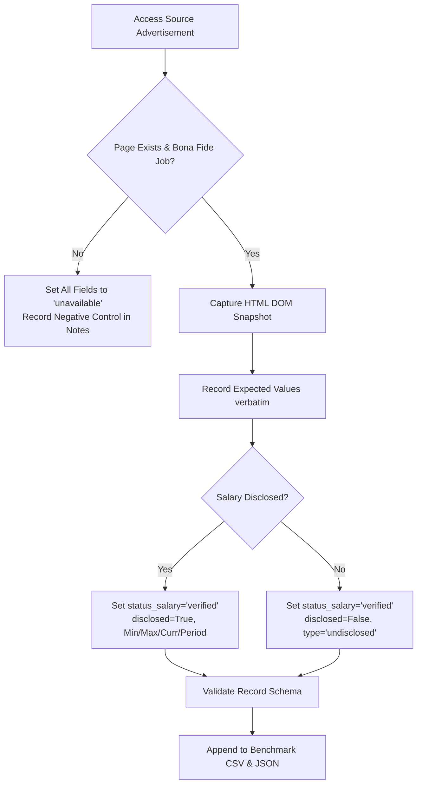

# Benchmark Dataset Annotation Guide & Protocol
**Project:** IT Job Market Intelligence Tool (J26_SE_355)  
**Target:** Human Reviewers and Research Evaluators  

---

## 1. Core Principles of Verification

Every ground truth entry in the benchmark dataset must adhere to five non-negotiable principles:

1. **Primary Evidence Primacy:** The original source page DOM or API response is the sole authoritative evidence for expected values. Never use scraper output as the basis for ground truth.
2. **Strict Field Disaggregation:** Never use an overall `verified` flag. Every field must have an explicit status: `verified`, `unavailable`, `ambiguous`, or `not_reviewed`.
3. **No Fabrication on Missing Data:** If an advertisement does not disclose salary, deadline, or hiring organization, mark the field as `unavailable`. Never record default, estimated, or imputed values.
4. **Ephemerality Handling:** If a live source page has disappeared or expired, do not guess expected values. If a local DOM snapshot was preserved, verify against the snapshot; otherwise, mark unconfirmed fields as `unavailable` or `ambiguous` with notes.
5. **Privacy and Terms Compliance:** Do not store sensitive personal information (recruiter personal phone numbers, direct personal email addresses). Sanitize evidence snapshots before storage.

---

## 2. Field Annotation Decision Tree

### A. Job Title (`expected_job_title_raw`)
- **`verified`**: The vacancy title is clearly stated in the heading or structured metadata. Record verbatim.
- **`unavailable`**: The page is a non-job page (e.g. error page, search result, landing page). Expected value remains empty.
- **`ambiguous`**: Conflicting titles exist (e.g. meta title says "Java Developer" but page header says "Full Stack Lead"). Explain in `reviewer_notes`.

### B. Company / Employer (`expected_company_raw`)
- **`verified`**: Explicit hiring organization or staffing agency name is stated.
- **`unavailable`**: Explicitly confidential posting (e.g., "Leading Financial Client", "Confidential MNC"). Set value to "Confidential Employer".
- **`ambiguous`**: Ambiguity between staffing agency and end-client employer.

### C. Salary Fields
- If salary is mentioned (e.g., "$5,000 - $8,000 / month"):
  - `status_salary`: `verified`
  - `expected_salary_disclosed`: `True`
  - `expected_salary_min`: 5000.0
  - `expected_salary_max`: 8000.0
  - `expected_salary_currency`: "SGD"
  - `expected_salary_period`: "monthly"
  - `expected_salary_type`: "range"
- If salary is omitted, negotiable, or competitive:
  - `status_salary`: `verified` (the fact that it is undisclosed is verified!)
  - `expected_salary_disclosed`: `False`
  - `expected_salary_min`: empty
  - `expected_salary_max`: empty
  - `expected_salary_currency`: country currency or empty
  - `expected_salary_period`: "unspecified"
  - `expected_salary_type`: "undisclosed"
  - `expected_salary_text_raw`: verbatim phrase (e.g. "Best in industry" or empty)

### D. Geographic Location & Work Mode
- **`expected_location_raw`**: Verbatim location string from the page.
- **`expected_country_normalized`**: Standardized name (`Sri Lanka`, `India`, `Singapore`, `Malaysia`).
- **`expected_city_normalized`**: Urban center from regional gazetteer.
- **`expected_work_mode`**:
  - `remote`: Full remote explicitly permitted.
  - `hybrid`: Combination of office and home work mentioned.
  - `on_site`: Physical office presence required.
  - `unspecified`: Work arrangement mode not mentioned. (Never assume remote work due to absence of location).

---

## 3. Step-by-Step Annotation Workflow

1. **Step 1:** Ingest URL into evidence capture.
2. **Step 2:** Inspect DOM elements and Schema.org metadata.
3. **Step 3:** Assign unique `benchmark_id` following pattern `BM-[CC]-[PLATFORM]-[NUM]`.
4. **Step 4:** Fill in expected values and individual status columns.
5. **Step 5:** Record timestamp in ISO 8601 UTC and reviewer ID.
6. **Step 6:** Validate schema consistency using `python -m src.evaluation.schema`.
