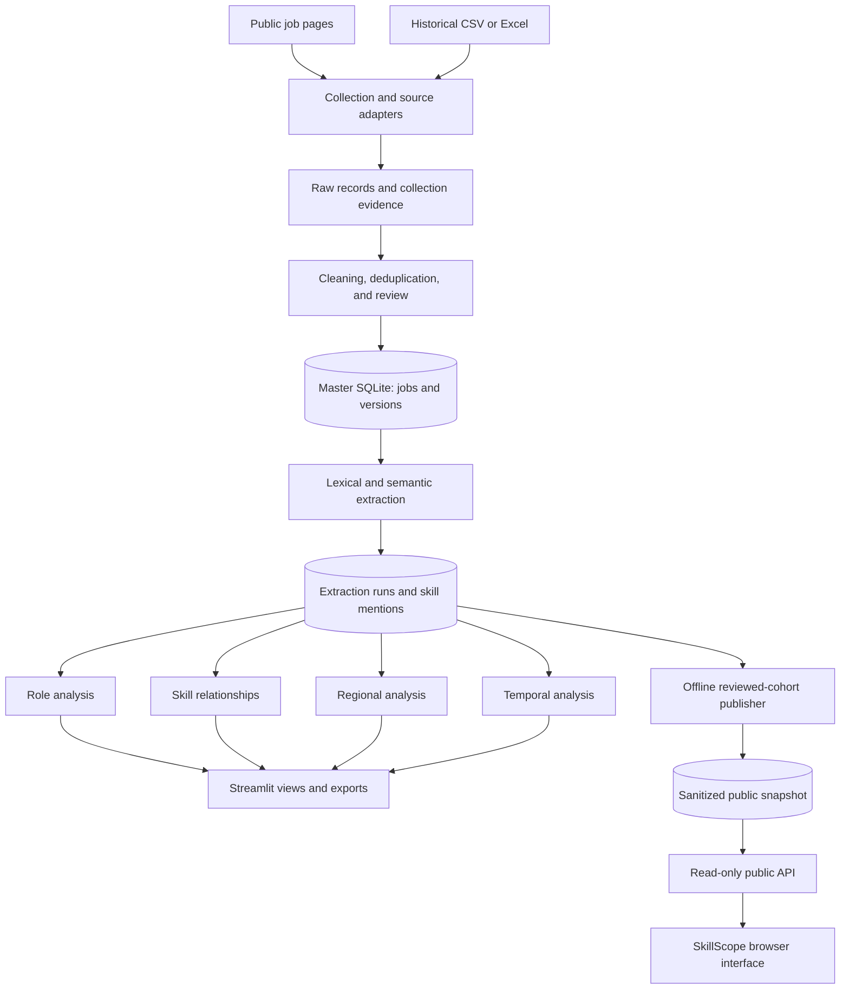

# About the Project

## Purpose and research scope

**Quantitative Analysis Framework for Technical Skill Identification in IT Sector Jobs** (J26-SE-355) studies employer-requested technologies in online IT job advertisements. Sri Lanka is the focal market; selected regional markets provide comparisons. Programming languages, frameworks, databases, cloud platforms, and related tools are technical skills in this context: Python and Django are examples, not the application's implementation stack.

The framework is intended to help students, job seekers, educators, curriculum planners, and researchers examine four related questions:

| Analysis area | Question | Current implementation |
| --- | --- | --- |
| Role-based demand | Which skills are associated with each IT role? | Rule-based role classification, within-role skill frequencies, distinctiveness statistics, and lexical/semantic ranking comparisons. |
| Skill relationships | Which skills appear together as technology stacks? | Co-occurrence counts, Jaccard similarity, PMI, pairwise association rules, frequent combinations, and network metrics. |
| Regional comparison | How does the observed Sri Lankan sample compare with other markets? | Country-level demand, skill gaps, profile similarity, role comparisons, and supplementary salary summaries. |
| Temporal analysis | How does skill demand change over time? | Monthly/quarterly demand rates, trend screening, exploratory forecasts, and extraction-method sensitivity. |

Across these branches, the methodological question is whether **lexical versus semantic extraction changes the resulting findings**. A semantic method is not assumed to be more accurate, and similar charts do not establish equivalent extraction accuracy. Ground-truth extraction evaluation and downstream conclusion sensitivity are separate tasks.

## Documentation basis

Research intent comes from the supplied **TAF Latest (1).pdf**, particularly sections 5-9 and the architecture diagram, and **IT23210042_Proposal_Report_261021_193752.pdf**, particularly chapters 2-5. The latter defines Munasinghe A T's temporal component. These are proposal sources, not evidence that every proposed feature exists.

See the [temporal analysis guide](Temporal_Analysis_Component.md), [current issues](suggestions.md#current-issues), and [implementation roadmap](roadmap.md). The [archive](archive/) contains historical project material.

## Architecture and data flow

The repository now has two runtime boundaries: local Python/Streamlit research tools using the master database, and **SkillScope**, an independently runnable public web application with a read-only WSGI API and a separate SQLite publication. The public image excludes the research pages, collection tools, master database, and ML dependencies. Deployment configuration is provided; no external hosting has been provisioned by this implementation.

The research/admin interface supports light and dark appearances through the Streamlit menu. Shared component styling lives in `theme.py` and native widget styling in `.streamlit/config.toml`.

The research views offer explicit matched-run selection. A matched run identifies the jobs that completed both extraction methods, including successful zero-skill results. Runs show their data provenance. Legacy views and default exploratory extraction exclude synthetic rows. Regional, temporal, salary, and role measures apply their own eligibility rules, so compare the displayed denominators. The regional CLI also supports explicit CSV inputs.

### Collection and preparation

`src/scraping/service.py` coordinates bounded live collection: listing discovery, HTTP fetching, optional browser rendering, optional advertisement-image OCR, classification, batch output, and manifest generation. The extractor registry tries structured JSON-LD, dedicated adapters, then generic HTML. Dedicated adapters currently cover Topjobs, MyCareersFuture, Shine, and TimesJobs. Generic extraction does not establish reliable support for every portal.

`src/scraping/historical_importer.py` maps uploaded columns into the raw schema and attaches source/batch metadata. Import timestamps describe ingestion, not the original advertisement date. Historical files must supply usable source information; the master import requires a non-empty source URL. The proposal's historical-data target does not mean those records have already been collected.

`src/cleaning/` removes presentation noise, normalizes fields, filters records, detects duplicates, and distinguishes IT, non-IT, and ambiguous cases. The shared cleaned export carries data provenance and classification status. Review and quality-report pages expose additional checks. Downstream analyses still have measure-specific eligibility.

### Skill extraction and canonical representation

`config/skill_taxonomy.json` defines the extraction vocabulary and aliases. The lexical extractor uses case-insensitive, boundary-aware regular expressions over aliases. The semantic extractor splits text into candidate fragments, embeds them and taxonomy skill descriptions with `sentence-transformers/all-MiniLM-L6-v2`, and retains skills whose maximum cosine similarity meets a threshold. This is a closed-taxonomy system; it cannot independently discover arbitrary new skill names.

Both methods use the shared text builder in `src/extraction/input_text.py`, combining title, description, and requirements. Provenance labels distinguish description, OCR/hybrid, and title-fallback cases, although the builder still concatenates available description text when it marks a fallback.

The TAF proposes TF-IDF/keyword and NER/SBERT approaches. **The current extractors implement alias matching and embedding similarity; they do not implement TF-IDF or a trained NER pipeline.** `src/extraction/normalization.py` adds canonical-name normalization for analytics, with definitions partly duplicated outside the JSON taxonomy. Canonical mapping is not itself human validation.

Semantic thresholds differ by entry point: the extractor and Python API default to `0.58`; the combined extraction CLI and Extract Skills page initially use `0.45`. Record the actual threshold for every comparison. Combined mode takes the union of lexical and semantic skills; it is not an additional independently validated extractor.

### Analysis layers

Role classification uses `config/role_taxonomy.json`: longer alias phrases take precedence, titles are checked first, and descriptions provide a fallback. `src/roles/` also contains distinctiveness and resampling comparisons.

Relationship analysis in `src/analytics/` treats each job's selected skills as a set. Pairwise rules expose support, confidence, and lift; frequent-stack mining enumerates combinations of up to four skills by default. NetworkX is imported for graph centrality and community calculations. Associations describe co-mentions, not causal relationships or learning prerequisites.

The regional configuration currently includes **Sri Lanka, India, Singapore, and Malaysia**. India is a South Asian comparator, not a Southeast Asian country; this is a scope difference from the TAF's selected Southeast Asian framing. Source-registry validation labels and embedded access-policy notes are configuration assertions, not independently verified permissions or current live-site guarantees. Salary analysis is supplementary and uses fixed indicative exchange rates, not live rates or purchasing-power adjustments.

Temporal analysis is implemented in `src/analytics/temporal_analysis.py` and `pages/13_Temporal_Analysis.py`; its limitations are documented in the component guide.

## Storage and reproducibility

The default database is `data/master_jobs.sqlite3`, resolved from the repository location in `src/database/connection.py`. The optional Docker admin service mounts `data/admin/` at the container's data directory, so its database lives at `data/admin/master_jobs.sqlite3` on the host. Initialization creates tables and applies additive compatibility changes. SQLite connections enable foreign keys and WAL mode.

| Tables | Role |
| --- | --- |
| `jobs`, `job_versions`, `import_runs`, `import_run_jobs` | Current advertisements, content versions, ingestion history, and membership in each successful import. Replays record membership without adding a content version. |
| `skills`, `extraction_runs`, `extraction_run_jobs`, `extracted_skills` | Canonical skill entries, run configuration, per-job input fingerprints and method completion, and method-specific mentions. Matched extraction is saved in one transaction. |
| `benchmark_jobs`, `evaluation_runs`, `evaluation_errors` | Reference annotations and scraper-evaluation outputs. |
| `regional_analysis_runs` | Regional run summaries and reports. |

Temporal series and forecasts are currently calculated in memory and exported as CSVs; there are no dedicated temporal-result tables. Relationship outputs are largely CSV/JSON files under `data/analytics/`; role outputs include files under `data/analysis/`. Research sessions also generate raw/processed batches, logs, and reports, many of which are ignored by Git. A checkout therefore does not contain every artifact needed to reproduce every historical result.

The Collect Data page can reopen a saved raw batch and its paired cleaned files in a new session. New append operations also store their combined raw scope and parent batch ID. Regional Analysis reads the master without automatically importing jobs or saving a run during refresh.

New combined runs record the semantic threshold, model identifier, pinned default model revision, and taxonomy digest. Mentions store the lexical match or highest-scoring semantic fragment and the semantic score where available. The `original_span` column retains the input provenance label. Older runs may lack these details. The selected run becomes unavailable if the linked master text or content hash changes.

## Technology stack and repository map

| Area | Technologies / location |
| --- | --- |
| Research application | Python, Streamlit; `app.py`, `app_shared.py`, `theme.py`, `pages/` |
| Public application | Standard-library Python WSGI/SQLite API, vanilla JavaScript, CSS, accessible SVG charts; `public_dashboard/`. Gunicorn/Docker for production. |
| Data and statistics | pandas, NumPy, SciPy, scikit-learn |
| Semantic extraction | Sentence Transformers and its PyTorch dependency; `src/extraction/` |
| Collection | Requests, Beautiful Soup, lxml, optional Playwright/Chromium; `src/scraping/` |
| Image text | pytesseract/Pillow and an externally installed Tesseract executable |
| Visualization | Plotly, Altair, Streamlit; graph computation uses NetworkX |
| Persistence | Python `sqlite3`, CSV/JSON, openpyxl for XLSX import |
| Configuration | `config/`; `requirements-admin.txt` for the dashboard and `requirements-extraction.txt` for semantic extraction. `requirements.txt` installs both. |
| Verification | `unittest` suites in `tests/` and alongside some source modules; HTML fixtures in `tests/fixtures/`, synthetic data in `test_data/` |

## Public dashboard and publication boundary

SkillScope is launched with `python -m public_dashboard.app`; the research app remains `python -m streamlit run app.py`. The browser interface integrates skill/career exploration, monthly demand, market comparisons, co-mentioned technologies, extraction-method sensitivity, and available baseline outlooks. Shared market, career, source, date, and method filters update the underlying cohort. Selecting a skill changes the detail without filtering away the denominator. Cross-market comparison deliberately lifts only the market filter and explains this in the view.

The public interface uses a blue palette with light/dark semantic colors for surfaces, controls, status labels, and charts. Its keyboard-accessible Dark mode toggle follows the device preference until explicitly chosen, then remembers the choice in browser storage when available. Appearance is independent of analytical state and shared URLs. Theme startup uses a same-origin external script under the existing Content Security Policy; no external assets or dependencies are added.

`tools/publish_dashboard.py` is an offline publisher. It accepts either its reproducible synthetic fixture or an explicit reviewed job cohort from one saved master extraction run. Empirical publication still requires a cohort CSV confirming both methods completed, including zero-result jobs. The local **Public Dashboard** Streamlit page provides these publication controls and a link to SkillScope.

The separate `data/public/dashboard.sqlite3` snapshot contains `metadata`, sanitized `jobs` attributes, canonical `job_skills`, and offline `forecasts`. It excludes raw advertisement text, URLs, companies, credentials, and original job IDs. Metadata retains provenance, hashes, extraction configuration, dates, and a synthetic-data flag. Publications replace atomically. The public process opens this database read-only, has no mutation/admin API, and never initializes the research schema.

`public_dashboard/data.py` calculates filter-dependent counts, proportions, pair association measures, and transparent recent-window signals. This is lightweight aggregation of published facts, not execution of research scraping/extraction/model training. Rates retain zero-skill advertisements; complete calendar grids distinguish genuine zero demand from insufficient/no observations. Public trend signals compare two adjacent three-month windows, using ±2 pp screening thresholds. These are deliberately explicit consumer summaries, not aliases for the existing research page's slope-based heuristic classifications or distinctiveness tests.

The publisher materializes last-value/three-month-average baseline outlooks only for scopes with at least 18 consecutive months and five jobs per month. Candidate selection uses the latest six expanding-window one-step errors. Forecasts are restricted to their published country/role/method and full date/source scope; unsupported filter combinations show an explanation. The displayed MAE is model-selection evidence, not independent confirmation of three-step accuracy. No Random Forest, uncertainty intervals, or research-model results are implied by these baseline outputs.

The synthetic fixture contains 4,896 jobs over November 2023–October 2026, four markets, and five career areas. It is generated in a separate database and marked throughout the interface and CSV exports. The master research dataset is untouched. Use `Dockerfile.dashboard` and `compose.dashboard.yaml` to deploy only the public app with a read-only publication-directory mount; the root README contains launch/publication/deployment commands. The application uses no remotely hosted scripts, fonts, or chart assets.

All findings describe the selected sample. Uneven portal coverage, missing dates, OCR errors, title-only inputs, reposts, taxonomy choices, and extraction thresholds can affect conclusions. Research measures and the public publisher apply their documented eligibility rules.
