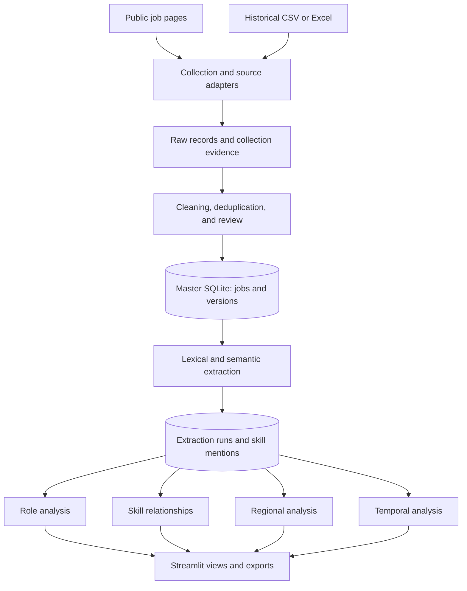

# About the Project

## Purpose and research scope

**Quantitative Analysis Framework for Technical Skill Identification in IT Sector Jobs** (J26-SE-355) studies employer-requested technologies in online IT job advertisements. Sri Lanka is the focal market; selected regional markets provide comparisons. Programming languages, frameworks, databases, cloud platforms, and related tools are technical skills in this context: Python and Django are examples, not the application's implementation stack.

The framework is intended to help students, job seekers, educators, curriculum planners, and researchers examine four related questions:

| Analysis area | Question | Current implementation |
| --- | --- | --- |
| Role-based demand | Which skills are associated with each IT role? | Rule-based role classification, within-role skill frequencies, distinctiveness statistics, and lexical/semantic ranking comparisons. |
| Skill relationships | Which skills appear together as technology stacks? | Co-occurrence counts, Jaccard similarity, PMI, pairwise association rules, frequent combinations, and network metrics. |
| Regional comparison | How does the observed Sri Lankan sample compare with other markets? | Country-level demand, skill gaps, profile similarity, role comparisons, and supplementary salary summaries. |
| Temporal analysis | How does skill demand change over time? | Monthly/quarterly demand rates, trend screening, exploratory forecasts, and extraction-method sensitivity. |

Across these branches, the methodological question is whether **lexical versus semantic extraction changes the resulting findings**. A semantic method is not assumed to be more accurate, and similar charts do not establish equivalent extraction accuracy. Ground-truth extraction evaluation and downstream conclusion sensitivity are separate tasks.

## Documentation basis

Research intent comes from the supplied **TAF Latest (1).pdf**, particularly sections 5-9 and the architecture diagram, and **IT23210042_Proposal_Report_261021_193752.pdf**, particularly chapters 2-5. The latter defines Munasinghe A T's temporal component. These are proposal sources, not evidence that every proposed feature exists.

Implementation descriptions below were checked against repository code on **2026-11-14**. The material in [archive/](archive/) is historical, unverified documentation; it is not the authority for current behavior. The [Temporal Analysis Component](Temporal_Analysis_Component.md) explains that branch in detail. [suggestions.md](suggestions.md) records concrete gaps and recommended work. Other component owners can maintain their own guides separately.

## Architecture and data flow

The implementation is a local Python application with Streamlit pages, reusable processing modules, CSV artifacts, and a shared SQLite database. There is no separate backend web API or deployed publication service in the current source.

This shows the main database workflow. Several pages also accept session data or saved CSVs, and the regional branch has benchmark/prediction-file fallbacks. Consequently, pages do not yet guarantee an identical input cohort or extraction run.

### Collection and preparation

`src/scraping/service.py` coordinates bounded live collection: listing discovery, HTTP fetching, optional browser rendering, optional advertisement-image OCR, classification, batch output, and manifest generation. The extractor registry tries structured JSON-LD, dedicated adapters, then generic HTML. Dedicated adapters currently cover Topjobs, MyCareersFuture, Shine, and TimesJobs. Generic extraction does not establish reliable support for every portal.

`src/scraping/historical_importer.py` maps uploaded columns into the raw schema and attaches source/batch metadata. Import timestamps describe ingestion, not the original advertisement date. Historical files must supply usable source information; the master import requires a non-empty source URL. The proposal's historical-data target does not mean those records have already been collected.

`src/cleaning/` removes presentation noise, normalizes fields, filters records, detects duplicates, and distinguishes IT, non-IT, and ambiguous cases. The pipeline maintains a richer internal frame and a shared output frame. Review and quality-report pages expose additional checks. Some eligibility metadata is lost or defaulted on paths through the shared schema, so downstream eligibility still needs consolidation.

### Skill extraction and canonical representation

`config/skill_taxonomy.json` defines the extraction vocabulary and aliases. The lexical extractor uses case-insensitive, boundary-aware regular expressions over aliases. The semantic extractor splits text into candidate fragments, embeds them and taxonomy skill descriptions with `sentence-transformers/all-MiniLM-L6-v2`, and retains skills whose maximum cosine similarity meets a threshold. This is a closed-taxonomy system; it cannot independently discover arbitrary new skill names.

Both methods use the shared text builder in `src/extraction/input_text.py`, combining title, description, and requirements. Provenance labels distinguish description, OCR/hybrid, and title-fallback cases, although the builder still concatenates available description text when it marks a fallback.

The TAF proposes TF-IDF/keyword and NER/SBERT approaches. **The current extractors implement alias matching and embedding similarity; they do not implement TF-IDF or a trained NER pipeline.** `src/extraction/normalization.py` adds canonical-name normalization for analytics, with definitions partly duplicated outside the JSON taxonomy. Canonical mapping is not itself human validation.

Semantic thresholds differ by entry point: the extractor and Python API default to `0.58`; the combined extraction CLI and Extract Skills page initially use `0.45`. Record the actual threshold for every comparison. Combined mode takes the union of lexical and semantic skills; it is not an additional independently validated extractor.

### Analysis layers

Role classification uses `config/role_taxonomy.json`: longer alias phrases take precedence, titles are checked first, and descriptions provide a fallback. `src/roles/` also contains distinctiveness and resampling comparisons.

Relationship analysis in `src/analytics/` treats each job's selected skills as a set. Pairwise rules expose support, confidence, and lift; frequent-stack mining enumerates combinations of up to four skills by default. NetworkX is imported for graph centrality and community calculations. Associations describe co-mentions, not causal relationships or learning prerequisites.

The regional configuration currently includes **Sri Lanka, India, Singapore, and Malaysia**. India is a South Asian comparator, not a Southeast Asian country; this is a scope difference from the TAF's selected Southeast Asian framing. Source-registry validation labels and embedded access-policy notes are configuration assertions, not independently verified permissions or current live-site guarantees. Salary analysis is supplementary and uses fixed indicative exchange rates, not live rates or purchasing-power adjustments.

Temporal analysis is implemented in `src/analytics/temporal_analysis.py` and `pages/13_Temporal_Analysis.py`; its limitations are documented in the component guide.

## Storage and reproducibility

The default database is `data/master_jobs.sqlite3`, resolved from the repository location in `src/database/connection.py`. Initialization creates tables and applies additive compatibility changes. SQLite connections enable foreign keys and WAL mode. There is no external database server to configure.

| Tables | Role |
| --- | --- |
| `jobs`, `job_versions`, `import_runs` | Current advertisements, content versions, and ingestion history; source URLs identify duplicate imports. |
| `skills`, `extraction_runs`, `extracted_skills` | Canonical taxonomy entries, run metadata, and method-specific job-skill mentions. |
| `benchmark_jobs`, `evaluation_runs`, `evaluation_errors` | Reference annotations and scraper-evaluation outputs. |
| `regional_analysis_runs` | Regional run summaries and reports. |

Temporal series and forecasts are currently calculated in memory and exported as CSVs; there are no dedicated temporal-result tables. Relationship outputs are largely CSV/JSON files under `data/analytics/`; role outputs include files under `data/analysis/`. Research sessions also generate raw/processed batches, logs, and reports, many of which are ignored by Git. A checkout therefore does not contain every artifact needed to reproduce every historical result.

Extraction-run metadata exists, but readers apply different selection rules, some merging all runs. Stored skill confidence is currently `1.0` for both methods, and `original_span` is populated from a provenance label rather than an actual matched span. These fields must not be presented as calibrated semantic confidence or exact text evidence.

## Technology stack and repository map

| Area | Technologies / location |
| --- | --- |
| Application | Python, Streamlit; `app.py`, `app_shared.py`, `theme.py`, `pages/` |
| Data and statistics | pandas, NumPy, SciPy, scikit-learn |
| Semantic extraction | Sentence Transformers and its PyTorch dependency; `src/extraction/` |
| Collection | Requests, Beautiful Soup, lxml, optional Playwright/Chromium; `src/scraping/` |
| Image text | pytesseract/Pillow and an externally installed Tesseract executable |
| Visualization | Plotly, Altair, Streamlit; graph computation uses NetworkX |
| Persistence | Python `sqlite3`, CSV/JSON, openpyxl for XLSX import |
| Configuration | `config/`; dependencies in `requirements.txt` |
| Verification | `unittest` suites in `tests/` and alongside some source modules; HTML fixtures in `tests/fixtures/`, synthetic data in `test_data/` |

NetworkX and Pillow are used directly but currently arrive through transitive dependencies rather than explicit entries in `requirements.txt`.

## Current application boundary and interpretation

The multipage app includes collection, cleaning, review, extraction, evaluation, and analytical tools. `pages/0_User_Dashboard.py` already presents a consumer-oriented view, but it reads detailed master records, initializes the database, and computes results at runtime inside the same application. Hiding controls does not create an independent deployment or read-only data boundary.

The intended next stage is to let research tools prepare and publish analysis data to a database, then let a separate user-facing dashboard read those results. That separation, its result schema, and its deployment are **future work**, not a feature implemented by this documentation pass.

All findings describe the collected advertisement sample. Uneven portal coverage, missing dates, OCR errors, title-only inputs, reposts, taxonomy choices, and extraction thresholds can affect conclusions. Temporal and regional percentages currently have different eligibility behavior; compare them only after aligning cohorts and denominators. Passing software tests does not validate the underlying market sample or prove the research hypotheses.
